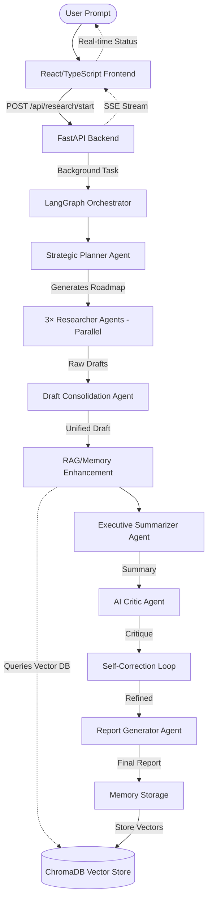

# 🌌 Prism AI: Autonomous Multi-Agent Research Assistant

[](https://www.python.org/)
[](https://fastapi.tiangolo.com/)
[](https://react.dev/)
[](https://www.trychroma.com/)
[](https://groq.com/)
[](https://langchain-ai.github.io/langgraph/)

Prism AI is a premium, state-of-the-art multi-agent research platform designed to automate deep technical research, synthesize publication-grade reports, critique analytical findings, and index intelligence records into a long-term vector memory store. Built on a **FastAPI** backend with **LangGraph** orchestration and a **React/TypeScript** frontend dashboard, Prism coordinates an array of specialized AI agents working collectively to turn simple search prompts into comprehensive technical briefs.

---

## ⚡ Why Use Prism?

Conducting high-fidelity technical research is usually a manual, multi-step process involving documentation gathering, outlines, drafting, and critical reviews. Prism eliminates this overhead by orchestrating a dedicated neural pipeline:

*   **Deep Semantic Memory (RAG)**: Automatically searches and retrieves related historical research from past sessions, injecting context to prevent repeating queries.
*   **Structured Output Design**: Delivers multi-section documents with clean visual layouts (Executive Summary, AI Critic Evaluation, and Full Reports).
*   **Real-Time Streaming (SSE)**: Monitors agent execution progress via Server-Sent Events, with live status updates displayed on the dashboard.
*   **Multi-Workspace Isolation**: Separate research contexts into isolated ChromaDB workspaces to keep projects independent.
*   **PDF RAG Chat**: Upload academic papers, chunk and index them into vectors, and have conversations grounded in the paper's content.
*   **Fully Configurable Control**: Fine-tune API keys, LLM providers, and workspace selection from a centralized settings panel.

---

## 🤖 The Neural Agent Network

Prism distributes research work across highly specialized AI agents orchestrated by a LangGraph state machine:

```
┌────────────────────────────────────────────────────────────────────────┐
│                        1. Strategic Planner                            │
│     Architects a systematic investigation roadmap with key goals.      │
└──────────────────────────────────┬─────────────────────────────────────┘
                                   ▼
┌────────────────────────────────────────────────────────────────────────┐
│               2. Elite Researchers (×3 parallel)                       │
│     Queries databases, scans references, and builds raw reports.       │
└──────────────────────────────────┬─────────────────────────────────────┘
                                   ▼
┌────────────────────────────────────────────────────────────────────────┐
│                     3. Draft Consolidation Agent                       │
│         Merges parallel research drafts into a unified document.       │
└──────────────────────────────────┬─────────────────────────────────────┘
                                   ▼
┌────────────────────────────────────────────────────────────────────────┐
│                      4. RAG/Memory Enhancement                         │
│        Enriches draft with past research from ChromaDB vectors.        │
└──────────────────────────────────┬─────────────────────────────────────┘
                                   ▼
┌────────────────────────────────────────────────────────────────────────┐
│                     5. Executive Summarizer                            │
│   Distills vast papers/reports into high-density conceptual digests.    │
└──────────────────────────────────┬─────────────────────────────────────┘
                                   ▼
┌────────────────────────────────────────────────────────────────────────┐
│                          6. AI Critic                                  │
│    Scores clarity, spots bias, and highlights missing perspectives.    │
└──────────────────────────────────┬─────────────────────────────────────┘
                                   ▼
┌────────────────────────────────────────────────────────────────────────┐
│                      7. Self-Correction Loop                           │
│      Refines report based on critic's feedback for quality boost.      │
└──────────────────────────────────┬─────────────────────────────────────┘
                                   ▼
┌────────────────────────────────────────────────────────────────────────┐
│                      8. Report Generator Agent                         │
│    Compiles the publication-grade final report with citations.          │
└──────────────────────────────────┬─────────────────────────────────────┘
                                   ▼
┌────────────────────────────────────────────────────────────────────────┐
│                        9. Memory Storage                               │
│   Generates vector embeddings and indexes findings in ChromaDB.        │
└────────────────────────────────────────────────────────────────────────┘
```

1.  **Strategic Planner Agent**: Outlines investigation roadmaps, establishes research objectives, and defines key technical subtopics.
2.  **Elite Researcher Agents (×3)**: Execute in parallel with staggered delays — each handles a subtopic, conducting granular knowledge retrieval from academic APIs (ArXiv, CrossRef, Semantic Scholar) and web search.
3.  **Draft Consolidation Agent**: Merges the three parallel research drafts into a single unified document.
4.  **RAG/Memory Enhancement**: Searches ChromaDB for relevant past research and injects context into the consolidated draft.
5.  **Executive Summarizer Agent**: Translates complex, technical jargon into high-impact summaries.
6.  **AI Critic Agent**: Provides adversarial review, scoring the research (1–10) and evaluating weaknesses, bias, and missing details.
7.  **Self-Correction Loop**: Automatically refines the report based on critic feedback.
8.  **Report Generator Agent**: Compiles the final publication-grade report with proper structure and citations.
9.  **Memory Storage**: Transforms text blocks into semantic vector embeddings using Hugging Face transformers and saves them permanently.

---

## 📐 System Architecture & Workflow

The following diagram illustrates the lifecycle of a research prompt from initial entry to permanent storage in the ChromaDB vector database:



---

## 🛠 Tech Stack & Dependencies

Prism uses a state-of-the-art tech stack to maximize performance, response latency, and visual appeal:

| Layer | Technologies |
| :--- | :--- |
| **Frontend** | React 18, TypeScript, Vite, TailwindCSS, Lucide Icons, EventSource (SSE streaming) |
| **Backend API** | FastAPI, Uvicorn, Python 3.11, Asyncio BackgroundTasks, StreamingResponse |
| **Orchestration** | LangGraph StateGraph engine with async node execution |
| **Multi-Agent Stack** | Strategic Planner, 3× Parallel Researchers, Draft Consolidation, Summarizer, AI Critic, Self-Correction Loop, Report Generator |
| **RAG & Vector DB** | ChromaDB (Multi-Workspace Isolation), Sentence Transformers (`all-MiniLM-L6-v2`) |
| **Tools & Data** | ArXiv API, CrossRef API, Semantic Scholar API, Playwright Browser Tool, PDF Parser (PyMuPDF), PDF Export Engine |
| **LLM Infrastructure** | Multi-Key Rotation Engine (Groq, Gemini, OpenAI, NVIDIA, DeepSeek, xAI) with automatic failover |

---

## 📁 Repository Structure

```
├── agents/                          # Multi-Agent Python Framework
│   ├── planner_agent.py             # Outlines research goals & objectives
│   ├── researcher_agent.py          # Compiles primary technical papers
│   ├── draft_consolidation_agent.py # Merges parallel research drafts
│   ├── summarizer_agent.py          # Distills drafts into executive briefs
│   ├── critic_agent.py              # Performs analytical & bias audits
│   └── report_agent.py              # Generates final publication-grade report
├── orchestrators/                   # Pipeline Orchestration
│   ├── agent_orchestrator.py        # LangGraph StateGraph engine
│   └── self_correction_loop.py      # Automatic quality refinement
├── tools/                           # Scraping, Search & Utility Tools
│   ├── academic_search_tool.py      # ArXiv, CrossRef, Semantic Scholar
│   ├── browser_tool.py              # Headless Playwright page extractor
│   ├── web_search_tool.py           # Web search scraper (Tavily/Serper/DuckDuckGo)
│   ├── groq_client.py              # Multi-key LLM rotation engine
│   ├── pdf_parser_tool.py           # PDF text extraction & RAG chunking
│   ├── pdf_generator.py             # Markdown → PDF export engine
│   └── citation_formatter.py        # Academic citation formatting
├── memory/                          # ChromaDB Vector Storage
│   ├── chroma_store.py              # Vector client & workspace isolation
│   └── memory_manager.py            # RAG pipelines & vector insertions
├── backend/                         # FastAPI REST Backend
│   ├── api.py                       # API router aggregation
│   ├── routes.py                    # All REST endpoints (12 routes)
│   ├── schemas.py                   # Pydantic request/response models
│   ├── config.py                    # Backend configuration
│   ├── middleware.py                # CORS and middleware setup
│   └── services/                    # Business logic services
│       ├── research_service.py      # Research task orchestration
│       ├── memory_service.py        # Memory CRUD operations
│       └── pdf_service.py           # PDF upload & chat service
├── frontend/                        # React SPA Dashboard
│   ├── index.html                   # HTML entry point
│   ├── vite.config.ts               # Vite build configuration
│   ├── tailwind.config.js           # TailwindCSS theme config
│   ├── package.json                 # Node.js dependencies
│   └── src/
│       ├── App.tsx                  # Root application component
│       ├── api.ts                   # Backend API client
│       ├── types.ts                 # TypeScript type definitions
│       ├── index.css                # Global styles
│       └── components/
│           ├── ResearchConsole.tsx   # Main research pipeline UI
│           ├── WorkflowVisualizer.tsx# Live agent progress tracker
│           ├── ReportViewer.tsx      # Rendered report display
│           ├── MemoryBank.tsx        # ChromaDB memory explorer
│           ├── PdfChat.tsx          # PDF upload & RAG chat modal
│           ├── SettingsModal.tsx     # API key & config panel
│           └── Sidebar.tsx          # Navigation sidebar
├── database/                        # Persistent data storage
├── tests/                           # Test suite (81 tests)
├── docs/                            # Project documentation
├── main.py                          # FastAPI application entrypoint
├── requirements.txt                 # Python dependencies
└── README.md                        # This file
```

---

## 🚀 Setup & Execution Guide

### Prerequisites
*   **Python 3.11+**
*   **Node.js 18+** (for frontend build)
*   At least one LLM API Key (Groq, Gemini, or OpenAI)

### 1. Clone & Environment Setup
```bash
# Clone the repository
git clone https://github.com/SahilSurani/Autonomous-Multi-Agent-Research-Assistant.git
cd Autonomous-Multi-Agent-Research-Assistant

# Create and activate virtual environment
python -m venv venv

# Windows (PowerShell)
.\venv\Scripts\Activate.ps1

# macOS/Linux
source venv/bin/activate

# Install Python dependencies
pip install -r requirements.txt
```

### 2. Configuration
Copy the example environment file and add your API keys:
```bash
cp .env.example .env
```

Edit `.env` with your keys:
```env
GROQ_API_KEY=gsk_your_groq_api_key_here
GEMINI_API_KEY=your_gemini_api_key_here
TAVILY_API_KEY=tvly_your_tavily_key_here
```

> **Tip:** You can also configure API keys at runtime via the Settings panel in the UI.

### 3. Install Frontend Dependencies
```bash
cd frontend
npm install
```

### 4. Run the Application

**Option A — Development Mode (recommended):**

Terminal 1 — Start FastAPI backend:
```bash
python main.py
# or: uvicorn main:app --host 0.0.0.0 --port 8000 --reload
```

Terminal 2 — Start React dev server:
```bash
cd frontend
npm run dev
```

Open your browser at `http://localhost:5173` (Vite dev server).

**Option B — Production Mode (single server):**
```bash
# Build the React frontend
cd frontend
npm run build
cd ..

# Start FastAPI (serves both API and static frontend)
python main.py
```

Open your browser at `http://localhost:8000`.

---

## 📊 Dashboard Modules

*   **Research Engine (`ResearchConsole`)**: Enter a research topic, watch the live multi-agent pipeline execution with real-time SSE streaming, and view the final structured report with executive summary and AI critique.
*   **Memory Bank (`MemoryBank`)**: Browse all encoded vector memory entries stored in ChromaDB, search by semantic similarity, and manage research history across workspaces.
*   **PDF RAG Chat (`PdfChat`)**: Upload academic PDFs, automatically chunk and index them into ChromaDB vectors, then ask natural language questions with source-grounded answers showing similarity scores.
*   **Settings (`SettingsModal`)**: Configure API keys for multiple LLM providers (Groq, Gemini, OpenAI, NVIDIA, DeepSeek), manage workspace selection, and view system status.

---

## 🧪 Testing

Run the full verification test suite from the project root:
```bash
python scratch/verify_tests.py
```

This executes **81 tests** covering:
- Module imports and function verification
- PDF creation, validation, and text extraction
- Chunking strategies (semantic & sliding window)
- ChromaDB ingestion and RAG retrieval
- Academic search tool validation
- Report heading cleaning
- Workspace isolation verification

---

## 📜 References & Acknowledgements
*   [FastAPI Documentation](https://fastapi.tiangolo.com)
*   [React Documentation](https://react.dev)
*   [LangGraph Documentation](https://langchain-ai.github.io/langgraph/)
*   [Chroma Vector Database Docs](https://docs.trychroma.com)
*   [Sentence Transformers (SBERT)](https://sbert.net)
*   [Groq API Docs](https://console.groq.com/docs)
*   [Vite Build Tool](https://vite.dev)
