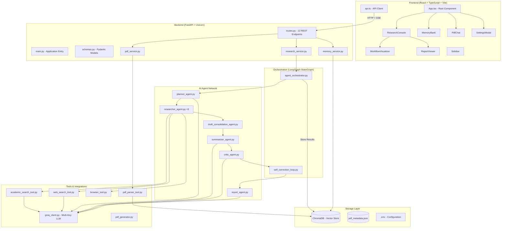

# System Architecture — Prism AI

## Overview

Prism AI follows a **3-tier architecture** consisting of a React frontend, a FastAPI backend, and a LangGraph-powered multi-agent orchestration engine backed by ChromaDB vector storage.

---

## Architecture Diagram



---

## Layer Details

### 1. Frontend Layer (React SPA)

| Component | File | Responsibility |
|-----------|------|----------------|
| App | `App.tsx` | Root component, tab routing, workspace state |
| Sidebar | `Sidebar.tsx` | Navigation, workspace selector, connection status |
| ResearchConsole | `ResearchConsole.tsx` | Research input, SSE streaming, result display |
| WorkflowVisualizer | `WorkflowVisualizer.tsx` | Live agent pipeline progress tracker |
| ReportViewer | `ReportViewer.tsx` | Markdown report rendering with export |
| MemoryBank | `MemoryBank.tsx` | ChromaDB memory explorer with search |
| PdfChat | `PdfChat.tsx` | PDF upload, ingestion, and Q&A chat |
| SettingsModal | `SettingsModal.tsx` | API key management and configuration |
| API Client | `api.ts` | Centralized HTTP/SSE client for backend |

**Tech:** React 18, TypeScript, Vite 5, TailwindCSS, Lucide React icons.

### 2. Backend Layer (FastAPI)

The backend exposes **12 REST endpoints** under the `/api/` prefix:

- **Research**: Start tasks, stream SSE events, get status
- **Memory**: List, get, delete memory items; list workspaces
- **PDF**: Upload PDFs, list files, chat with PDF
- **Export**: Convert markdown to PDF binary
- **Settings**: Get/update API keys and configuration

All long-running research tasks execute as **FastAPI BackgroundTasks** with real-time updates streamed via **Server-Sent Events (SSE)**.

### 3. Orchestration Layer (LangGraph)

The `AgentOrchestrator` class builds a **LangGraph StateGraph** that defines the execution DAG:

```
START → planner → researchers (×3 parallel) → draft_consolidation 
      → rag_enhancement → summarizer → critic → self_correction 
      → report_generator → memory_storage → END
```

Each node is an async function that:
1. Updates task status to `RUNNING`
2. Executes the agent logic via `run_in_executor`
3. Updates task status to `COMPLETED` or `FAILED`
4. Emits SSE events for real-time frontend updates

**State Schema** (`ResearchGraphState`): topic, workspace, plan, research_results, validated_text, memory_context, summary, critique, final_report, sources, logs, error.

### 4. Agent Layer

| Agent | Input | Output |
|-------|-------|--------|
| Strategic Planner | Topic string | Research plan with subtopics, objectives, methodology |
| Researcher (×3) | Subtopic + plan | Raw technical draft with academic citations |
| Draft Consolidation | 3 research drafts | Unified merged document |
| Summarizer | Consolidated draft | Executive summary |
| Critic | Draft + summary | Scored critique (clarity, depth, bias, completeness) |
| Self-Correction | Draft + critique | Refined draft addressing critic feedback |
| Report Generator | All outputs | Publication-grade final report |

### 5. Tools Layer

- **`groq_client.py`**: Unified LLM interface with automatic key rotation across Groq, Gemini, OpenAI, NVIDIA, DeepSeek, xAI. Implements round-robin failover on rate limits.
- **`academic_search_tool.py`**: Queries ArXiv, CrossRef, and Semantic Scholar APIs. Includes ranking, deduplication, and abstract cleaning.
- **`web_search_tool.py`**: Web search via Tavily, Serper, or DuckDuckGo with formatted context output.
- **`browser_tool.py`**: Playwright headless browser for extracting content from URLs.
- **`pdf_parser_tool.py`**: PDF text/table extraction using PyMuPDF. Supports semantic and sliding-window chunking strategies. Full ChromaDB ingestion pipeline.
- **`pdf_generator.py`**: Converts markdown reports to downloadable PDF binaries.

### 6. Storage Layer

- **ChromaDB**: Vector database with workspace-isolated collections. Each workspace gets its own `research_memories_{workspace}` and `pdf_documents_{workspace}` collections.
- **`pdf_metadata.json`**: Persistent JSON file tracking all ingested PDFs with metadata (title, chunks, sections, summary).
- **`.env`**: Runtime configuration for API keys, loaded via `python-dotenv`.

---

## Data Flow

1. **User** enters research topic in React frontend
2. **Frontend** sends `POST /api/research/start` and opens SSE stream
3. **Backend** creates a BackgroundTask running the `AgentOrchestrator`
4. **Orchestrator** executes LangGraph nodes sequentially, streaming status via SSE
5. Each **Agent** calls the LLM via `groq_client.py` with automatic key rotation
6. **Researchers** additionally query academic APIs and web search tools
7. Final report is compiled and stored as vector embeddings in **ChromaDB**
8. **Frontend** receives completed report via SSE and renders it in ReportViewer
