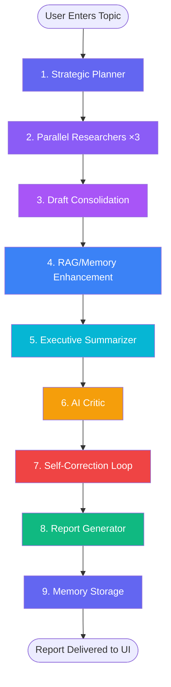

# Workflow Explanation — Prism AI

## Overview

Prism AI's multi-agent research pipeline transforms a simple text topic into a publication-grade research report through a 9-step automated workflow. The pipeline is orchestrated by a **LangGraph StateGraph** engine that manages execution order, parallel processing, error handling, and real-time status updates.

---

## Pipeline Execution Flow



---

## Step-by-Step Breakdown

### Step 1: Strategic Planner Agent
**Input:** Raw topic string (e.g., "Transformer attention mechanism in NLP")

**What it does:**
- Analyzes the topic to identify key research dimensions
- Generates a structured research plan with:
  - 3 subtopics for parallel investigation
  - Research objectives and goals
  - Methodology recommendations
  - Key questions to answer

**Output:** JSON plan object with subtopics, objectives, and methodology

**Why it matters:** Without strategic planning, researchers would all cover the same ground. The planner ensures comprehensive coverage by dividing the topic into complementary subtopics.

---

### Step 2: Parallel Researcher Agents (×3)
**Input:** Individual subtopic + overall plan + workspace context

**What it does:**
- Three researcher agents launch **in parallel** with staggered delays (0.8s apart to avoid API rate limits)
- Each researcher:
  1. Queries **ArXiv**, **CrossRef**, and **Semantic Scholar** for academic papers
  2. Runs **web search** via Tavily/Serper/DuckDuckGo for broader context
  3. Optionally uses **Playwright browser tool** for page content extraction
  4. Synthesizes findings into a detailed technical draft with citations

**Output:** Three independent research drafts covering different subtopics

**Key feature:** Parallel execution reduces total pipeline time by ~60% compared to sequential processing.

---

### Step 3: Draft Consolidation Agent
**Input:** Three research drafts from parallel researchers

**What it does:**
- Merges the three drafts into a single unified document
- Resolves contradictions and overlaps between drafts
- Ensures logical flow and structural coherence
- Preserves citations and source attributions from all drafts

**Output:** A single consolidated research document

---

### Step 4: RAG/Memory Enhancement
**Input:** Consolidated draft + workspace identifier

**What it does:**
- Searches the **ChromaDB vector database** for past research on related topics
- Uses sentence transformer embeddings (`all-MiniLM-L6-v2`) for semantic similarity matching
- Injects relevant historical context into the draft to:
  - Add depth from prior investigations
  - Cross-reference with previous findings
  - Avoid contradicting earlier established results

**Output:** Enhanced draft with additional context from vector memory

**Why it matters:** This is the RAG (Retrieval-Augmented Generation) step that makes the system smarter over time — each research session builds on all previous ones.

---

### Step 5: Executive Summarizer Agent
**Input:** Enhanced research draft

**What it does:**
- Distills the full technical draft into a concise executive summary
- Focuses on key findings, implications, and actionable insights
- Uses clear, non-technical language for broader accessibility
- Maintains accuracy while reducing length by ~80%

**Output:** Executive summary paragraph/section

---

### Step 6: AI Critic Agent
**Input:** Full research draft + executive summary

**What it does:**
- Performs adversarial analysis of the research, scoring it across multiple dimensions:
  - **Overall Score** (1–10)
  - **Clarity**: Is the writing clear and well-structured?
  - **Depth**: Are topics explored thoroughly with evidence?
  - **Bias**: Are alternative viewpoints considered?
  - **Completeness**: Are there missing perspectives or gaps?
- Provides specific, actionable improvement recommendations

**Output:** Structured critique object with scores and feedback

---

### Step 7: Self-Correction Loop
**Input:** Research draft + critic's feedback

**What it does:**
- Takes the critic's specific recommendations
- Automatically revises the research draft to address identified weaknesses
- Can run multiple rounds (configurable, default: 1 round)
- Each round targets different aspects flagged by the critic

**Output:** Refined research draft with quality improvements

**Configuration:** `self_correction_rounds` parameter in the research request (0–3).

---

### Step 8: Report Generator Agent
**Input:** Refined draft + summary + critique + plan

**What it does:**
- Compiles all outputs into a final publication-grade report
- Structures the document with proper sections:
  - Title and metadata
  - Executive Summary
  - Detailed findings by subtopic
  - Analysis and discussion
  - AI Critic evaluation
  - Sources and references
- Formats in clean Markdown with proper headings and citations

**Output:** Complete markdown report ready for display and export

---

### Step 9: Memory Storage
**Input:** Final report + topic + critique + summary

**What it does:**
- Generates semantic vector embeddings from the research content
- Stores the complete session in ChromaDB under the designated workspace
- Indexes content for future RAG retrieval
- Associates metadata (topic, timestamp, scores) for search filtering

**Output:** Persistent vector memory entry in ChromaDB

---

## Real-Time Monitoring (SSE)

Throughout the entire pipeline, the system streams **Server-Sent Events** to the frontend:

```
User Browser ←── SSE Stream ←── FastAPI ←── AgentOrchestrator
```

Each event contains:
- **Task statuses** (PENDING → RUNNING → COMPLETED/FAILED for each agent)
- **Duration** for each completed step
- **Log messages** with timestamps
- **Partial results** as they become available

The `WorkflowVisualizer` component in the frontend renders these updates as a live progress tracker showing which agents are active, completed, or failed.

---

## Error Handling & Resilience

- **Retry Logic:** Each agent supports up to 3 retries on failure
- **Timeout Protection:** 600-second timeout per agent node
- **LLM Failover:** If Groq rate limits, automatically switches to Gemini → OpenAI → NVIDIA
- **Key Rotation:** Round-robin rotation across multiple keys for the same provider
- **Graceful Degradation:** If non-critical agents fail (e.g., summarizer), the pipeline continues with available data
